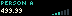

# Bill Splitter

Divide a bill by three weights down to the last cent with fair remainder allocation.

999.99 split 2:1:1 yields 499.99, 250.00 and 250.00, exactly 999.99.

Turn the wheel to browse results. Click to edit inputs, turn to change the selected value, click to select the next parameter, and press Start to return to results. Hold the wheel button in the editor to restore that parameter's starting value. Parameters persist on this device.

Inputs: Bill (cents) (0 to 2000000 ), Share A (0 to 100 ), Share B (0 to 100 ), Share C (0 to 100 ).

## Run locally

From this folder, run `~/.busy-emulator/bin/busy-emulator dev --once` with BUSY Bar Emulator open. Back exits.

