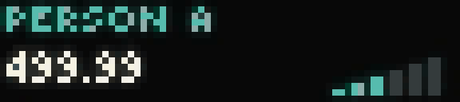

# Bill Splitter

Divide a bill by three weights down to the last cent with fair remainder allocation.

Read out three amounts that add back to the exact receipt total. Fractional cents are assigned once across the three shares, so nobody has to decide where a stray penny goes afterward.

## Read each person’s share

1. Open **Person A** and turn through B and C. The rear shows each person’s weight and the total bill.
2. With a 999.99 bill and weights 2, 1 and 1, read 499.99, 250.00 and 250.00.
3. Add the three to check the total. The clip moves between the first two people.



## Use a different receipt

1. Click to edit the total in cents. For example, 99999 means 999.99. Turn the wheel to change it and click to advance to the three share weights.
2. Use the same weight for an equal split. Zero removes a person’s share, provided at least one weight is positive.
3. Press **Start** to return to the amounts. Holding the wheel in the editor restores the selected field’s initial value.


## Example from the emulator

The calculation takes the whole-cent part of each proportional share first. Remaining cents go to the largest fractional remainders. Equal remainders are resolved in A, B, C order. An all-zero set of weights asks you to set shares.

## Run in the emulator

Open BUSY Bar Emulator. From this repository, run:

```sh
~/.busy-emulator/bin/busy-emulator dev --once
```

Press **Back** to exit.

The GIFs are excerpts from the emulator recording. Each front-display pixel is shown at 9× its original width and height. The end frames pause for reading.

[Full recording](media/controls.mp4) · [Rear display](screenshots/back-1.png) · [Firmware test](EMULATOR-QA.md) · [MIT license](LICENSE)
